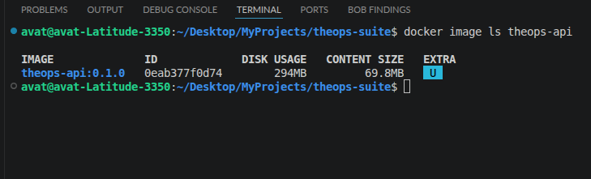
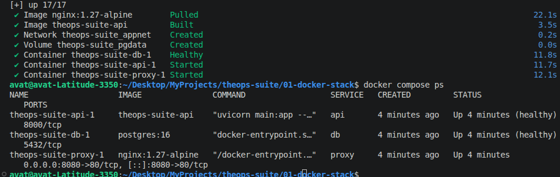
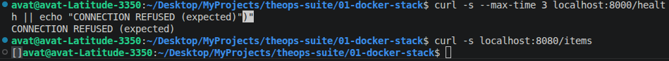
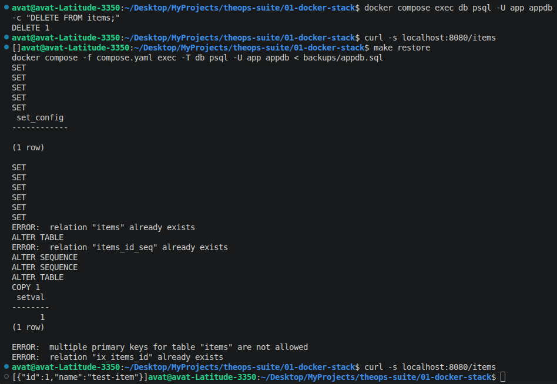

# Project 01 — Docker Stack

A production-style three-tier application stack built with Docker and Docker Compose.
Demonstrates multi-stage image builds, non-root containers, healthchecks, custom networks,
named volumes, and a tested backup/restore workflow.

---

## Architecture

```
┌─────────────────────────────────────────────────────┐
│                    Host machine                      │
│                                                      │
│   curl / browser                                     │
│        │                                             │
│        │  port 8080 (only published port)            │
│        ▼                                             │
│  ┌──────────────────────────────────────────────┐   │
│  │            Docker network: appnet            │   │
│  │                                              │   │
│  │  ┌─────────────┐      ┌─────────────────┐   │   │
│  │  │    proxy    │─────▶│      api        │   │   │
│  │  │ nginx:1.27  │ :80  │ theops-api:0.1.0│   │   │
│  │  │             │      │ FastAPI+SQLAlch. │   │   │
│  │  └─────────────┘      │ non-root user   │   │   │
│  │                        │ healthcheck     │   │   │
│  │                        └────────┬────────┘   │   │
│  │                                 │ :5432       │   │
│  │                        ┌────────▼────────┐   │   │
│  │                        │       db        │   │   │
│  │                        │  postgres:16    │   │   │
│  │                        │  volume: pgdata │   │   │
│  │                        └─────────────────┘   │   │
│  └──────────────────────────────────────────────┘   │
│                                                      │
│   port 8000 ✗ blocked — api not reachable directly  │
└─────────────────────────────────────────────────────┘
```

**Services:**

| Service | Image | Port | Role |
|---------|-------|------|------|
| `proxy` | `nginx:1.27-alpine` | `8080→80` (host→container) | Reverse proxy — only entry point |
| `api` | `theops-api:0.1.0` (built locally) | internal only | FastAPI app with SQLAlchemy ORM |
| `db` | `postgres:16` | internal only | PostgreSQL with named volume |

---

## How to Run

```bash
# 1. Clone the repo
git clone git@github.com:marigirom/theops-suite.git
cd theops-suite/01-docker-stack

# 2. Create your .env from the example
cp .env.example .env

# 3. Start the stack (builds the api image automatically)
make up

# 4. Test the API through the proxy
curl localhost:8080/health
curl localhost:8080/items

# 5. Insert an item
curl -X POST localhost:8080/items \
  -H "Content-Type: application/json" \
  -d '{"name": "hello"}'

# 6. Stop (data is preserved)
make down
```

---

## Image Size Comparison

Multi-stage builds eliminate build tools from the final image.

| Build approach | Base image | Size |
|---|---|---|
| Single-stage (naive) | `python:3.12` | ~1.1 GB |
| Multi-stage (this project) | `python:3.12-slim` (final stage only) | **294 MB** |

The difference comes from two decisions:
1. The `builder` stage installs gcc, pip, and all compile-time dependencies — none of these land in the final image.
2. The final stage starts from `python:3.12-slim` (no dev packages) and only copies the pre-built `/venv`.



---

## Evidence Screenshots

**Stack running — all three services:**



**Security boundary — only proxy is reachable:**



**Backup and restore:**



---

## Backup and Restore

```bash
# Take a backup (writes to backups/appdb.sql, gitignored)
make backup

# Restore from backup
make restore
```

The `backups/` folder is gitignored — dump files never reach GitHub.

---

## Key Design Decisions

| Decision | Why |
|---|---|
| Multi-stage Dockerfile | Build tools stay out of the final image — smaller attack surface and faster pulls |
| Non-root user (`appuser`) | If the app is compromised, the attacker doesn't get root inside the container |
| `HEALTHCHECK` on `/health` | Docker marks the container unhealthy automatically; Compose uses this for `depends_on` ordering |
| `depends_on: condition: service_healthy` | API never starts before Postgres is ready — no connection-refused crashes on startup |
| Named volume `pgdata` | Data survives `docker compose down`; only `down -v` deletes it — accidental data loss is harder |
| Custom network `appnet` | Isolates the stack; only the proxy's port 8080 is reachable from the host |
| `.env` + `.env.example` | Secrets stay off GitHub; the example file documents what variables are needed |

---

## Lessons Learned

- Multi-stage builds require discipline about what goes in each stage — copying only `/venv` (not the whole builder filesystem) is the key step.
- `HEALTHCHECK` without `depends_on: condition: service_healthy` is useless — the healthcheck must be referenced in the dependent service or Docker ignores it for startup ordering.
- `docker compose exec -T` (the `-T` flag) is required for backup/restore piping — without it, terminal control characters corrupt the SQL dump.
- Running as non-root is a one-liner in a Dockerfile but is often skipped in tutorials. It is always asked about in interviews.
- SQLAlchemy's `create_all` connects to the DB at app startup — wrapping it in a try/except makes the image testable standalone without a live database.

---

## What I Would Do Next

- Scan the image with **Trivy** and fix any HIGH/CRITICAL CVEs
- Add `read_only: true` to the `api` service with a `tmpfs` for `/tmp`
- Push the image to **GHCR** and reference it in Compose instead of building locally
- Add **TLS** termination at the Nginx proxy with a self-signed cert
- Deploy to **EKS** (Project 02 and 03 steps in this direction)
